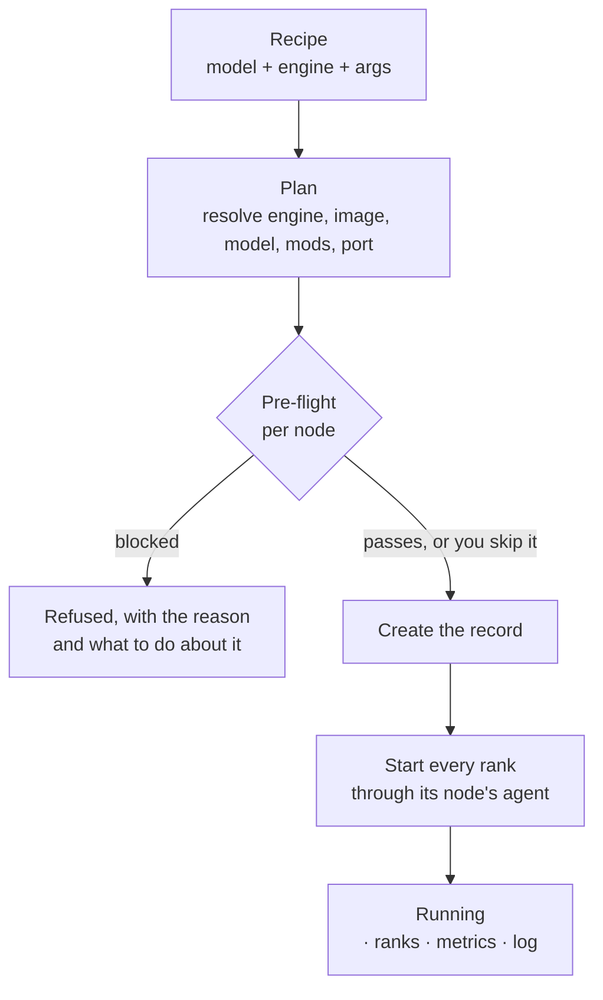
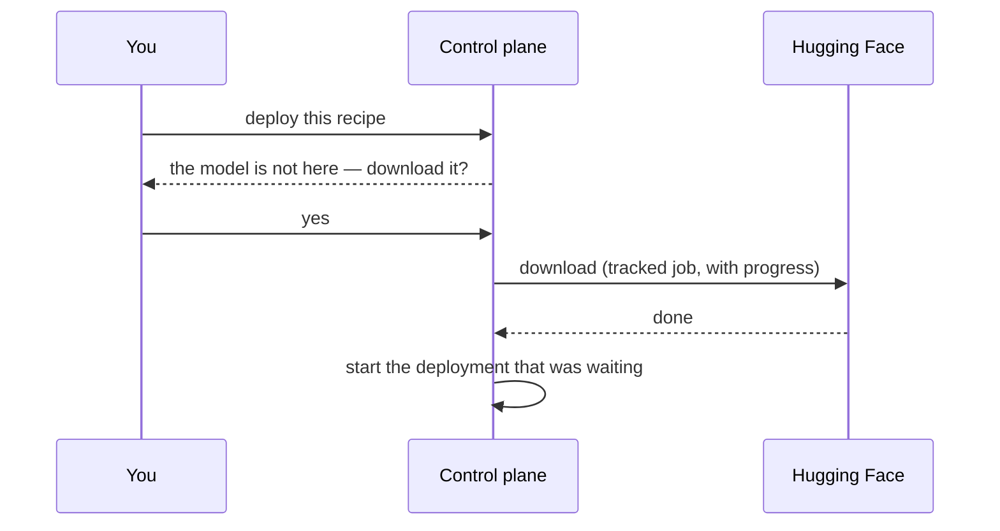

# Deploying a model

## The path a deploy takes



**Plan** resolves everything up front — which engine, which image at which digest, which model, which mods, which port — and starts nothing. It is what the Deploy preview shows you, and it is the same call the API exposes as `POST /api/deployments/plan`.

**Kubernetes** is a second reading of the same plan, offered under the preview and never applied. *Render manifests* turns the run into what a cluster would be given: a `Deployment` for one rank, a `LeaderWorkerSet` for a vLLM or SGLang run across several, a `Service` in front of the API port, and the Hugging Face cache as a `PersistentVolumeClaim` or a host path (the choice beside the button, or `kubernetes.hf_cache` in `settings.json`; `hf_cache_claim`, `hf_cache_path`, `hf_token_secret` and `namespace` sit beside it). The token is a reference to a Secret, never its value. Under the YAML are the **findings**: what the manifests needed that the run's description does not carry — how many GPUs a rank uses, where the model file is, the engine's user, ulimits, mods — each said rather than guessed. The same call is `POST /api/deployments/plan/kubernetes`. A run that spans nodes over llama.cpp's RPC backend is refused there: the head needs each worker's address, and nothing in the plan names one a pod would have.

**Pre-flight** then asks each node the questions a deploy would otherwise discover the hard way: is Docker there, is the image there, is the port free, is there disk, is there memory. A *blocked* verdict refuses the create — every condition it blocks on is one the deploy would hit anyway, minutes later, with a container already pulled and a worse error. `skip_preflight` is there for when you have judged the report wrong.

A pre-flight is honest about the difference between a wait and a failure: an image that is not on a node yet is a **delay**, not a block, and the report says how many bytes have to move first.

## Ports

A recipe's port is a **preference**. If a node the run will occupy already holds it — a run on record there, or a listener the node itself reports through its agent — the plan moves the run to the first free port in `default_port_range_start`…`_end` and says who held it (*port 8000 is held by run qwen; this run gets 9000*). That is how two runs share a node. A node that cannot be asked is not assumed free: the plan judges it by the records alone, says so, and the pre-flight asks again before anything starts.

A port you type in **Deploy options** (or send as `params.port`) is a **pin**: kept exactly as given, and blocked by the pre-flight if it is taken. Leave the field empty to take the recipe's preference.

Readiness is checked against *this* run's server. Where the engine's readiness path is its model listing (vLLM's `/v1/models`), a 200 has to name the run's served model — `--served-model-name` if the command sets one, else the model as the command hands it to the engine. A 200 naming another model is somebody else on that port: the deploy keeps waiting, and if the deadline passes the error says which model answered.

## Sharing a node

A port is the first thing two runs on one node collide on; memory is the second. `gpu_memory_utilization` (SGLang's `--mem-fraction-static`) is a fraction of the node's **total** memory — on a GB10, the 121 GiB unified pool — and the engine takes all of it at startup. vLLM checks that fraction against what is *free* and refuses with *"Free memory on device … is less than desired GPU memory utilization"*, but only after the image is pulled and the container started.

So the plan does the arithmetic first. For each node the run occupies, it lists the runs already there — live ones, and a stopped one whose containers were never confirmed gone — and what each claims:

- a run whose engine takes a fraction claims that fraction of the node's total;
- a run whose engine allocates as it goes (llama.cpp) claims what the node, asked through its agent, says its containers hold;
- a run counts at the **largest** of what its fraction entitles it to, what the node measures it holding, and what a run of the same recipe and settings was seen holding before (below) — SGLang's static fraction leaves out its CUDA graphs and its heap, and llama.cpp grows its cache under load;
- a run whose claim cannot be read — the node did not answer, or reports no memory for it — is **unknown**, never zero.

What is left is the total, less those claims, less 4 GiB for the host itself (the kernel, Docker, the agent: memory no run's fraction may count on) — and never more than what the node says is free right now, less 2 GiB when somebody else is on it, because that figure moves by a couple of gigabytes from one minute to the next. The free figure is what catches memory no run of ours holds: a download, a container somebody started by hand, the desktop. A run that asks for more is **blocked** — *run qwen holds 0.80 (96.9 GiB); at most 0.16 is left and this run asks 0.50* — and an unknown co-tenant turns the check into a warning instead, since the budget has a hole in it. Alone on its node, a run is blocked only when the node's free memory is short of its claim, which is the engine's own check run early.

**GPU memory** in Deploy options sets the fraction (empty takes the recipe's). After a preview, every node gets a bar — each run on it, the host reserve, memory held outside any run, this run's claim and what is free — and a node somebody else is on gets one line — *Shares spark-01 with qwen (0.80). Up to 0.16 fits.* — with a button that takes that value when the run does not fit. The plan carries the same figures as `memory_budget`, one entry per node.

### Does the model fit inside its fraction?

Fitting beside the others is half the question; the model then has to fit in the fraction it was given. vLLM sizes its KV cache from what is left of the fraction after the weights and refuses — *no available memory for the cache blocks* — after the load. The pre-flight's **GPU memory** line estimates weights (measured from the snapshot on the node) plus the KV cache at the run's context, and when that is more than the fraction it says by how much and offers the two ways down: the smallest fraction that holds it (a one-click value in the preview, when that much is left beside the others) and the longest context that fits in the fraction as given.

### Checked again at the launch

The plan is judged before the image pull, and on a Spark the pull fills the unified pool with page cache. So after the pull, before any container is made, each node is asked again whether this run's claim is free — less whatever runs still starting there have claimed and not yet mapped. Short of it, the page cache is dropped (on a node another run is serving on, only that: compaction would stall it), and the launch waits up to `memory.launch_wait_seconds` (90 by default) for the memory to come — a run beside one that is stopping gets it a moment later. If it does not, the run fails before anything was started, with the numbers and who holds them:

> not enough free memory on spark-01 to start the engine: it asks 0.12 of 121.6 GiB (14.6 GiB) and 11.2 GiB is free after waiting 90s (run inkling holds 85.6 GiB; 21.4 GiB is held outside any run). To start it, lower gpu_memory_utilization to 0.09 or less, or stop a run on this node

A node that cannot be asked is let through with an event saying so — the engine's own check is still there. Settings → Memory turns the check off (`memory.check_before_launch`) or changes the wait. The control node can drop its caches only when the `spark-pulse` service unit lets its agent use sudo; a unit written before this release carried `NoNewPrivileges`, and an event says to reinstall it (`spark-pulse install`, `--user` for a user service).

### What a run was seen holding

Every minute, each node a ready run is on is asked what that run's containers hold, and the largest figure is kept against the run's intent hash — what the run *is*, whatever it was called — and the node's size in whole GiB. The next plan of the same thing on a node of that size counts at least that much, for itself and as a co-tenant: an estimate is replaced by a measurement once there is one. The figure only rises.

When an engine fails before it is ready, its error keeps the exception lines from above the last 20 log lines under *Root cause:* — vLLM's last lines are its API server's wrapper traceback, and the line that says why is further up, in a container that may have been removed by the time anybody looks.

## Deploying a model that is not downloaded

The create is not refused. It comes back with a structured `detail.missing_model`, which the UI turns into an offer:



The waiting deployment is recorded, so a restart in the middle of a 26 GB download does not lose it: reconciliation at startup settles anything the completion hook could not.

## One machine or several

The same form. A recipe declares what it needs; if you name several nodes, the deployment is a gang of ranks — one container per rank, each started through its own node's agent, all carrying the same generation so a half-started attempt can be told from a running one.

## What a recipe serves

A v2 recipe can say what kind of endpoint it starts with a top-level `serves:` — `chat`, `embedding`, `image`, `video` or `speech`. Absent means `chat`, so every recipe written before the field existed is unchanged.

```yaml
recipe_version: "2"
name: Qwen3-Embedding-4B
model: Qwen/Qwen3-Embedding-4B
serves: embedding
engine: vllm
engines:
  vllm: {}
```

- **vLLM** renders `--runner pooling` for `embedding`, unless the recipe's own args (or the deploy's extra args) already name a `--runner`.
- **Every other engine** refuses a kind it does not claim, at plan time and in the recipe's engine table, with the reason. SGLang's `--is-embedding` and `llama-server`'s `--embedding` exist, but nothing here has launched them; a refusal is cheaper than a run that starts and answers the wrong API.
- **The run keeps it.** The deployment record carries `serves` from the moment it is planned, so editing or uninstalling the recipe later does not change what an existing run says it is. A record without the field is `chat`.
- **Benchmarks are chat only.** llama-benchy drives chat completions, so `POST /api/benchmarks` answers 409 for a run that serves anything else, and the run row does not offer the button.
- **v1 serves chat.** Its `command` is a verbatim `vllm serve` line nothing rewrites, so a v1 recipe that claims another kind fails validation; declare it in v2.

`image`, `video` and `speech` are reserved for an engine that serves them; today no engine claims them, so a recipe naming one is refused at plan time. The published schemas are in `spark_pulse/schemas/`.

## Stopping and removing

Both are the same button in different states, and they are different operations:

- **Stop** ends the containers and keeps the record. A finished run is history you read: which ports it held, which ranks came up, why it ended.
- **Remove** clears the record. That is a second, separate decision.

Either way the request returns as soon as the intent is recorded — the row shows *in progress* or *deleting* while the reconciler makes it true. See [reconciliation](../architecture/reconciliation.md) for why it works that way.

## Mods

A recipe can name mods — a `run.sh` plus assets, applied inside the container before the engine starts. They are copied into each rank's container at deploy time through that rank's node service. Mods are validated before they run: a `run.sh` that would `rm -rf /`, `mkfs`, reboot or shut down the machine is refused, and one that reaches the network is flagged.
