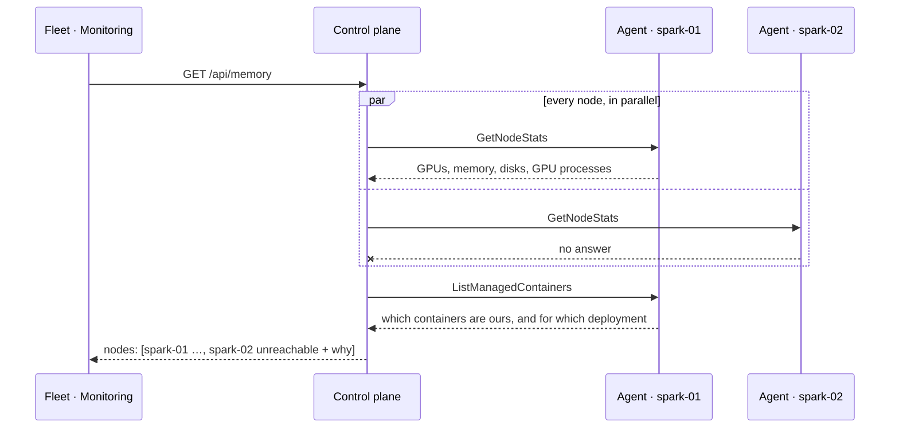

# Monitoring

Two different things are called monitoring here, and they come from different places.

## What the machines are doing

`GET /api/memory` and the `/sse/metrics` stream ask **every registered node** for its own stats through that node's agent — including the machine the control plane runs on.



Two halves decide whether a GPU process is *ours*: the node says which container the process is in — it can read that, the control plane cannot — and the control plane's managed-container list says which containers it started and for which deployment. So a held GPU names the deployment holding it, and anything else is *untracked*.

**Absent measurements stay absent.** A GB10 reports `[N/A]` for GPU memory because host and device share one pool. Every measurement in the protocol is optional, and the page says *unified memory — usage not reported by nvidia-smi* rather than drawing an empty bar for a full machine.

**A node that could not be asked keeps its section** and says why. A missing section and an idle machine look identical on a page.

### The shape of free memory

`MemAvailable` says how much memory is free, but not what shape it's in. On unified memory the GPU maps weights with large pages, and a large page needs a physically contiguous block under it. The agent reads `/proc/buddyinfo` (free blocks per order, summed over zones) along with the page size. `tools/memory_shape.py` turns that into **Contiguous free** on the node page: how much of the free memory is in blocks of 2 MiB or more, and the largest block. A card with memory of its own shows nothing, because the host's pool is not where its weights go.

The buddy allocator's free memory excludes the page cache, so it is usually far below `MemAvailable`. The pre-flight's **Memory shape** line reports that gap as cache the kernel can drop. It warns, and never blocks, when less than half of at least 1 GiB of free memory is in blocks of 2 MiB or more. The remedy it gives runs only with no engine on the node: `sudo sh -c 'sync; echo 3 > /proc/sys/vm/drop_caches; echo 1 > /proc/sys/vm/compact_memory'`. The 50% threshold is a first guess, to be moved by measurement.

For reference, a DGX Spark runs 4 KiB pages with 14 orders, so its largest possible block is 32 MiB. On 2026-11-23, 21 days up with a run loaded, one had 1.5 GiB free, 52% of it in 2 MiB+ blocks, and 22 GiB of cache.

### Compacting memory before a run

Settings → **Memory** has two switches and an **Enable all** button, saved with the rest of the form. Both are off by default.

**Compact before launch** (`memory.compact_before_launch`). After the images and the model are ready and before the first rank starts, the control plane asks each node of the run, in parallel, to run what the remedy above runs: `sync`, then `3` into `/proc/sys/vm/drop_caches`, then `1` into `/proc/sys/vm/compact_memory`. It is the agent's `CompactMemory` operation, and the agent is rootless, so each write goes through `sudo -n /usr/bin/tee <path>` with the value on stdin. The agent installer's sudoers drop-in, `/etc/sudoers.d/spark-pulse-agent-memory`, grants exactly those two argument vectors, with no wildcard:

```
<user> ALL=(root) NOPASSWD: /usr/bin/tee /proc/sys/vm/drop_caches, /usr/bin/tee /proc/sys/vm/compact_memory
```

Because the rule names the whole command line, it cannot be used to write any other file. It is installed under the same opt-in as the network rule (the browser onboarding sets it); a node enrolled before this existed needs its agent reinstalled once.

- **A node another run is on is skipped.** Dropping caches and compacting stall everything on the node, so a serving engine is left alone. The test is the one the port choice and memory budget use (`placement._occupied_nodes`), less the run being started.
- **It never fails the deploy.** A missing sudoers rule, an agent too old for the operation, a timeout (60 s per write) or a node that cannot be asked each leave an event saying so, and the run goes on.
- Each node leaves one event on the run, for example `spark-02: 25.1 GiB → 80.3 GiB free in blocks of 2 MiB or more`. The deploy preview says memory will be compacted when the switch is on.

**Lazy NCCL communicators** (`memory.lazy_nccl_communicators`, experimental). Sets `TORCH_DIST_USE_NCCL2=0` on every rank of a multi-node run, for any engine, so that torch builds NCCL communicators when first used rather than all at once. It applies to torch 2.16 and later; the claim that it returns memory on a head rank comes from one operator's three-node run and is not yet measured on our images. A recipe that sets the variable itself wins. It is part of how a run is deployed, not of what it is, so it does not change the run's `intent_hash`.

### Memory the operating system holds

DGX OS ships a full desktop, and on unified memory every MiB a background service holds is a MiB the model cannot have. Settings → **Memory** has a **Node clean-up** group with one switch per item, eight in all. **Enable all** there covers them too.

Switching one on means *check this*. It adds a finding to each node's doctor, and nothing is applied to any node from Settings. Applying is a click on one node's doctor, per node and per item, and each has a **Restore**. The doctor shows `3 of 7 applied` and what each unit holds now (`systemctl show -p MemoryCurrent`). A unit the node does not have is *not present*, not a finding. The default is none selected, so a fresh install's doctor reports nothing new.

| Item | Units | What it frees | What you lose | Undo |
|---|---|---|---|---|
| `desktop` | default target `multi-user.target`, `gdm3.service` | the GNOME session, about 1 GiB with a user logged in | an attached monitor shows a text console; SSH and the control plane are not affected | `set-default graphical.target`, `enable --now gdm3.service` |
| `bluetooth` | `bluetooth.service` | the Bluetooth daemon | Bluetooth keyboards and audio | `enable --now bluetooth.service` |
| `printing` | `cups.socket`, `cups.path`, `cups-browsed.service`, `cups.service` | the print server and its printer discovery | printing from the node | `enable --now` each unit |
| `snapd` | `snapd.socket`, `snapd.seeded.service`, `snapd.snap-repair.timer`, `snapd.service` | the snap daemon and its refresh timers | installed snaps stop updating, and any service a snap runs stops | `enable --now` each unit |
| `dgx_dashboard` | `dgx-dashboard.service`, `dgx-dashboard-admin.service` | the dashboard, whose update check peaks near 850 MiB and wakes fwupd and PackageKit | the dashboard page | `enable --now` each unit |
| `fwupd_refresh` | `fwupd-refresh.timer`, and a `stop` of `fwupd.service` | the daily firmware metadata refresh | automatic firmware update checks; run `fwupdmgr` by hand | `enable --now fwupd-refresh.timer` |
| `watermark_boost` | `vm.watermark_boost_factor` | up to 0.87 GiB of `MemAvailable` the kernel holds back after fragmentation | nothing measurable on a node that serves models | remove the file, set 15000 |
| `splash` | `splash` on the kernel command line (`/proc/cmdline`) | the boot splash | the graphical boot screen | add `splash` back, `update-grub`, reboot |

Notes on the items that need care:

- **The desktop and snapd ask first.** The node page puts a confirmation in front of both. The desktop's names the text console; snapd's lists every snap that would stop updating, read from `snap list`. Check that list first. On the node this was written from every snap was a desktop application, and Docker, the NVIDIA driver and Tailscale came from apt, so none of them were affected.
- **fwupd stays installed.** It delivers EC, UEFI, ConnectX-7 and NVMe firmware. Only the refresh timer is disabled. The running `fwupd.service` is stopped with `systemctl stop fwupd.service`, a stop with no disable, and `fwupdmgr` starts it again on demand, so undoing the item has nothing to put back for it.
- **The watermark boost** is written to `/etc/sysctl.d/90-watermark-boost.conf` and applied with `sysctl -w`. Restore removes the file and sets the kernel's default, 15000. The node's earlier value is not recorded, so a node that had a custom one gets the default back.
- **What is left alone.** `avahi-daemon`, `ModemManager`, `wpa_supplicant`, `udisks2`, `upower` and `multipathd` hold 2 to 25 MiB each. Several are how a node is found or reached (mDNS, Wi-Fi), and the saving is not worth a node that cannot be reached afterwards.
- **`splash` is advice only.** The doctor reads `/proc/cmdline` and, when `splash` is there, says so, with no Apply and no Restore, because the fix is a GRUB edit and a reboot. The finding gives the steps: edit `GRUB_CMDLINE_LINUX_DEFAULT` in `/etc/default/grub` to drop `splash`, run `sudo update-grub`, reboot. To go back, add `splash` to that line, run `sudo update-grub` and reboot. It has no sudoers line.
- **No packages are removed.** Disabling `gdm3` and the graphical target is the reversible equivalent of uninstalling GNOME: nothing is deleted, and Restore brings the desktop back.

How it is applied follows how the doctor repairs anything. On a peer, over SSH with the control plane's key: each command runs through `sudo` with the password typed into the doctor, or none if the agent's sudoers drop-in is installed. On the control node, which the doctor reads over its own agent and never changes over SSH, each finding carries the exact `sudo` lines to run there, for both directions. The agent installer's third drop-in, `/etc/sudoers.d/spark-pulse-agent-tuning`, installed under the same opt-in as the other two, grants one literal command per line and no wildcard:

```
<user> ALL=(root) NOPASSWD: /usr/bin/systemctl disable --now bluetooth.service
<user> ALL=(root) NOPASSWD: /usr/bin/systemctl enable --now bluetooth.service
<user> ALL=(root) NOPASSWD: /usr/bin/systemctl set-default multi-user.target
<user> ALL=(root) NOPASSWD: /usr/bin/systemctl set-default graphical.target
<user> ALL=(root) NOPASSWD: /usr/bin/tee /etc/sysctl.d/90-watermark-boost.conf
<user> ALL=(root) NOPASSWD: /usr/sbin/sysctl -w vm.watermark_boost_factor=0
<user> ALL=(root) NOPASSWD: /usr/sbin/sysctl -w vm.watermark_boost_factor=15000
<user> ALL=(root) NOPASSWD: /usr/bin/rm -f /etc/sysctl.d/90-watermark-boost.conf
<user> ALL=(root) NOPASSWD: /usr/bin/systemctl stop fwupd.service
```

The file has the same pair of lines for every unit named above. A unit name is not data, so each is pinned, and the rule cannot disable a unit the catalogue does not name. Settings keeps the choice in `memory.node_tuning`, a list of ids that must come from the catalogue in `spark_pulse/agent/node_tuning.py`.

### Ending a process

`DELETE /api/memory/processes/{pid}?node=…` works on any node:

- If the process is inside a container this control plane started, the **container** is stopped. Killing the process inside would leave the container holding its ports, and whatever supervises it would start the process again.
- Otherwise the process is signalled through that node's agent.

The same pid on two Sparks is two different processes, which is why the node is part of the address.

## What an engine is doing

Separately, a sampler scrapes each running deployment's own `/metrics` — Prometheus text — every five seconds into a ring of 720 readings: one hour, in memory, lost on restart. `GET /api/deployments/{id}/metrics` returns that window with an `available` / `reason` / `detail` triple, so a deployment publishing nothing (SGLang without `--enable-metrics`, an unreachable endpoint, a body nothing recognises) says which of those it is instead of showing an empty chart.

Token throughput is differenced from counters. A counter that goes backwards is an engine restart, so that interval's rate is `null` — never a negative spike.

There are no percentiles: both engines publish histograms only, and inventing a p99 from a histogram bucket would be making one up.

There is deliberately no persistence. Retention is Prometheus's job; this window exists so you can see the last hour without deploying one.
